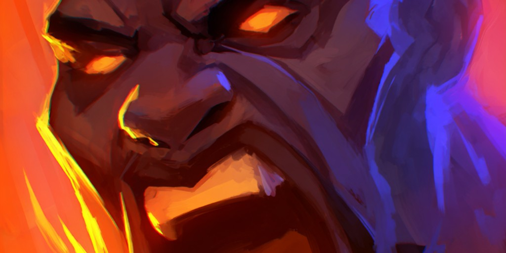
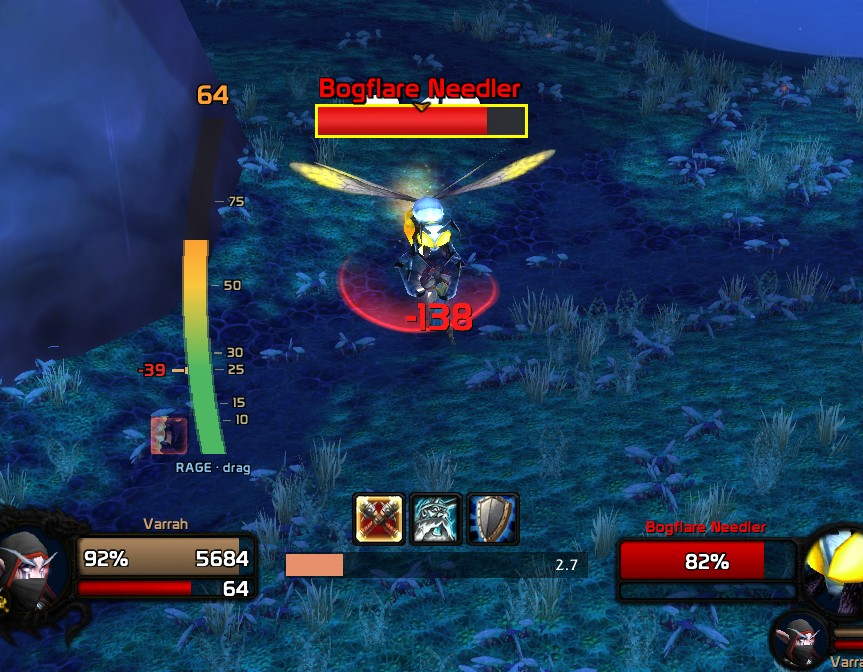
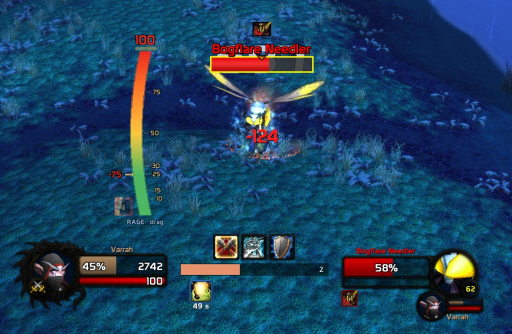
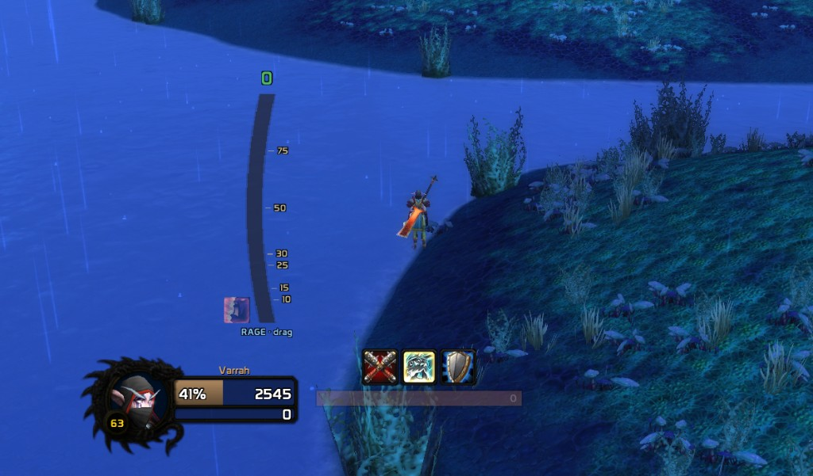

<h1 align="center">RageForge</h1>

<p align="center">
  <em>A smart rage display for stance-dancing warriors on WoW Classic
  Anniversary (TBC) and World of Warcraft: Forever. Built for PvP-first
  decision making.</em>
</p>

<p align="center">
  The default rage bar tells you a number. RageForge tells you the
  <strong>cost</strong> of your next stance dance, at a glance.
</p>

## Screenshots

### Mid-fight — reading the dump hint at a glance



*A realistic mid-combat read: 64 rage on the bar, **`-39`** ghost label and
ghost line on the left at the 25-rage retained mark. That tells you instantly
that stance-dancing right now costs 39 rage. The fill colors shift through
green (free) into gold and orange as the cost climbs.*

### Rage cap — the full color spectrum



*Capped at 100 rage. The full warrior palette is visible at once: emerald
(free dance) -> gold -> molten orange -> blood red (heavy loss). The `-75`
hint says you'd lose 75 rage if you danced now. The Battle Shout reminder
shows a live 49s countdown and starts flashing under 30 seconds.*

### Idle — the bar at 0 rage



*Idle bar at 0 rage, currently unlocked (`/rf lock` toggles this). Threshold
ticks at 10 / 15 / 25 / 30 / 50 / 75 sit outside the bar to the right. The
Battle Shout icon at the bottom-left appears whenever the buff is missing.*

## Creator

RageForge is built by **Chase Sommer**, a game designer who loves to play and
build addons and communities around WoW.

- X: https://x.com/SommerChase
- YouTube: https://www.youtube.com/@chasesommer
- Patreon: https://www.patreon.com/cw/chasesommer

## Why

If you've ever stood in front of a healer thinking "do I have enough rage to
dump and stance-dance into Overpower right now, or will I bleed out?" — this
addon answers that question without you doing math.

## Features (v0.10.1)

- **Smoother no-art curved bar** rendered as 1-pixel horizontal rows with
  full-opacity centers and soft left/right feather strips. Row centers are
  pixel-snapped to reduce sampling shimmer; feathering softens the visible
  staircase that rectangular UI textures naturally create on a curve.
- **Blended brighter rage colors** instead of hard zone bands. The retained
  rage band stays green, then smoothly blends through gold -> molten orange
  -> blood red as stance-dance cost increases.
- **Full-opacity current rage row** — the fill now rounds the animated value
  to the nearest whole rage before painting slices, so the current rage band
  never appears as a half-faded row.
- **Left-side decision hints** — the retained-rage notch, ghost line, and
  `-X` dump hint live on the left side of the bar, keeping the right side
  reserved for threshold tick labels.
- **Stance icon rail** — only **learned** stances from the stance bar
  (`GetNumShapeshiftForms` / `GetShapeshiftFormInfo`). Defensive / Berserker
  appear when unlocked (no hardcoded level checks); the rail re-packs with no
  gaps and refreshes on learn/level events. Icons are square-cropped and
  stay upright; inactive stances are alpha-dimmed only. Active stance uses
  Blizzard's action-button border as a gold outline.
- **Battle Shout reminder** — a Battle Shout icon appears at the bottom-left
  of the rage bar when the buff is missing or has less than 30 seconds
  remaining, then flashes until refreshed. If the buff is active but expiring,
  a countdown appears over the icon. Suppressed while dead or ghosted.
- **Researched rendering limitation:** Classic can crop/transform textures
  with `SetTexCoord`, and WeakAuras uses custom progress-texture math for
  circular displays, but Classic does not give arbitrary curved masking for
  our vertical bar. A perfect bend will require a custom TGA/BLP skin.
- **No background chrome.** When the bar is locked, nothing exists on
  screen except the bar, ticks, and labels. When unlocked, the "RAGE"
  label shifts to "RAGE \194\183 drag" in light blue as a subtle drag cue.
- **Options > AddOns** registration: Forever uses the modern Settings API;
  TBC uses `InterfaceOptions_AddCategory`. `/rf` opens that category. Forever
  also gets an Addon Compartment entry. Style radios (Ribbon / Blade / Classic)
  rebuild the bar live; a Reload UI button sits beside them.

- **Color-coded stance-dance economy zones**, dynamic to your Tactical
  Mastery rank:
  - **Green (0..retained)** — free dance, you keep everything.
  - **Yellow (retained..50)** — small loss on dance, fine in most cases.
  - **Orange (50..75)** — meaningful loss; consider dumping rage first.
  - **Red (75..100)** — heavy loss; dump rage *before* you dance.
- **Dump hint** — a live `-X` label next to the bar showing exactly how much
  rage you'd lose if you stance-dance right now. Yellow / orange / red by
  severity.
- **Ghost-line marker** — bright notch on the bar's left edge at the rage
  you'd land on after a dance, with a horizontal line extending to the
  dump-hint label. Hides entirely when a dance would lose nothing.
- **Threshold ticks** at 10 / 15 / 25 / 30 / 50 / 75 — the rage costs that
  matter (Overpower, HS, Hamstring, MS / Rend, post-dance floor, cap warn).
  Sit OUTSIDE the bar to the right; never cross the fill.
- **Rage-cap warning** — top of the bar pulses yellow within 5 rage of cap so
  you spot wasted rage in heated fights.
- **Consistent typography** — RageForge bundles `Prototype.ttf` in
  `RageForge/Fonts/` for the bar UI, with `Fonts\SKURRI.TTF` as a fallback.
  The bundled `Prototype.txt` from the font's author is shipped alongside it
  per the readme's redistribution note.
- **Drag-to-move + scale + lock** via slash commands. The bar is invisible
  chrome when locked; the `RAGE` label changes to `RAGE \194\183 drag` when
  unlocked so you know it can be moved.

## Install

### Option A: Copy (simple, recommended for normal use)

```powershell
cd C:\Users\rober\rageforge
.\install.ps1                  # TBC Anniversary (_anniversary_)
.\install.ps1 -Client Forever  # WoW Forever beta (_classic_beta_)
```

Anniversary installs into:

```
C:\Program Files (x86)\World of Warcraft\_anniversary_\Interface\AddOns\RageForge\
```

Forever beta installs into:

```
C:\Program Files (x86)\World of Warcraft\_classic_beta_\Interface\AddOns\RageForge\
```

(Live Forever's folder name may differ after launch — pass `-WowPath`.)

### Option B: Junction (recommended while developing / tweaking)

```powershell
.\install.ps1 -Symlink
.\install.ps1 -Symlink -Client Forever
```

This creates a directory junction so edits in this repo are immediately
visible in WoW. Just `/reload` in game (or relog) to pick up Lua changes.

Junctions don't require admin rights. If the WoW folder is in a non-default
location, pass `-WowPath`:

```powershell
.\install.ps1 -Symlink -WowPath "D:\Games\World of Warcraft\_anniversary_"
```

### Uninstall

```powershell
.\install.ps1 -Uninstall
```

## Release Packaging

For CurseForge, Wago, or GitHub releases, build a clean addon zip:

```powershell
.\package.ps1
```

That creates `dist\RageForge-v<version>.zip` with the required top-level
`RageForge\` folder (including all TOC flavors). `.pkgmeta` is included for
BigWigs / CurseForge packagers.

### Multi-flavor notes (CurseForge / Wago)

One zip, one `RageForge/` folder, multiple TOC files:

| TOC | Client | Interface |
| --- | --- | --- |
| `RageForge_TBC.toc` | Classic Anniversary / TBC | `20506` |
| `RageForge_Forever.toc` | WoW Forever | `16001` (Forever Beta) |
| `RageForge_Camelot.toc` | Forever beta internal alias | `16001` |
| `RageForge.toc` | unsuffixed fallback | `20506` |

When uploading with the BigWigs packager, detect both flavors from the TOC
Interface lines (or pass `-g bcc,forever`). `.pkgmeta` sets
`enable-toc-creation: no` so the packager keeps these hand-written files
(Forever has to load `ForeverDisplay.lua`). Forever's Interface number is
sourced from the Warcraft Wiki Forever Beta row and **may change at launch
(Nov 4 2026)** — confirm with `/dump select(4, GetBuildInfo())`.

`package.ps1` builds the same top-level `RageForge/` zip locally
(`dist/RageForge-v<version>.zip`). `.github/workflows/release.yml` runs
[BigWigsMods/packager](https://github.com/BigWigsMods/packager) on a tag
push. Before the first CurseForge upload, replace `## X-Curse-Project-ID: 0`
in every TOC with the real project id and add a repository secret named
`CF_API_KEY`.

## In-game usage

After installing, log in. You should see the bar to the left of center
screen.

**Easiest way to configure:** type `/rf`. You get a movable
RageForge settings window with checkboxes and sliders. Changes preview live.

For power users / scripts, every setting is also a slash command:

```
/rf options      open the RageForge settings window
/rf              open the RageForge settings window
/rf tm auto      detect retained rage from talents (default)
/rf tm 5         manual override: TBC 5/5 (25 rage retained)
/rf tm 3         manual override: TBC 3/5 (15 rage retained)
/rf tm 0         manual override: 0 rage retained
/rf tm 19        manual override: any 0-25 (Forever 3/5 is 19)
/rf lock         toggle lock; unlocked = drag to move
/rf scale 1.0    set UI scale (0.5 .. 2.0)
/rf reset        reset position to default
/rf ticks        toggle threshold tick marks
/rf stances      toggle stance icon rail
/rf ghost        toggle the ghost (post-stance-dance) line
/rf style <name> classic | ribbon | blade (then /reload)
/rf frame <name> none | iron | bloodforged | warlord (default none)
/rf outline <weight> thin | medium | thick (default medium)
/rf status       client / secret-value diagnostics (Forever)
```

`/rf tm auto` is the default. A number turns detection off and sets the
manual retained rage. `3` and `5` are the old TBC rank shortcuts (15 and 25).
Any other number from 0 to 25 is used as-is, which is how you pin a Forever
mid-rank such as 19.

## How the math works

A stance change drops rage to `min(currentRage, retainedRage)`.

| Client | Retained rage |
| --- | --- |
| TBC Anniversary | 5 per rank of Tactical Mastery. 0/5 = 0, 3/5 = 15, 5/5 = 25. No baseline. |
| WoW Forever beta 1.60.1 | 10 from the level-14 Tactical Mastery passive, plus 3 per rank of Improved Tactical Mastery. 0/5 = 10 (once learned), 3/5 = 19, 5/5 = 25. |

RageForge reads that rank when it can (`GetTalentInfo` on TBC, `C_Traits` on
Forever) and falls back to the manual value when the client does not report
one. Sources and the other warrior checks are in the next section.

So the value of a stance dance is:

```
rage_lost = max(0, currentRage - retainedRage)
```

The ghost line is drawn at `min(currentRage, retainedRage)`. The fill above
that line is, visually, "rage you're about to throw away if you dance now."

## WoW Forever beta warrior checks

Forever numbers below come from Forever beta pages only: the Wowhead Forever
spell database, Wowhead's Forever warrior guides, Blizzard's Forever warrior
deep dive, the 26 Sep 2026 client-verified Forever warrior talent table
(Arms, Fury, Protection), and the later Forever beta notes that change that
table. Classic comments posted on those spell pages are not used. If a
Forever source does not state a fact, the gap is listed instead of copying
a TBC or Classic Era number.

The TBC Anniversary client is a separate path in this addon (Tactical
Mastery is 5 rage per rank there). It is not used to fill a Forever gap.

| Check | What Forever beta sources say | Not stated in those Forever sources |
| --- | --- | --- |
| Rage kept on a stance change | Baseline passive [Tactical Mastery](https://www.wowhead.com/forever/spell=1310185/tactical-mastery), level 14: "You retain up to 10 Rage when you change Stances." The same tooltip shows 25 with the talent and 10 without. [Improved Tactical Mastery](https://www.wowhead.com/forever/spell=12295/improved-tactical-mastery) (Arms row 2, 5 ranks, trait 135485) adds 3/6/9/12/15. Blizzard's deep dive: each point adds 3, maximum 25. Client-verified rank text matches. So 0 points after level 14 is 10, 3/5 is 19, 5/5 is 25. | Nothing further. This is the number the ghost line uses. |
| Stances | Wowhead's Forever Protection guide names three: Battle, Defensive, Berserker. Forever spell pages: [Battle](https://www.wowhead.com/forever/spell=2457/battle-stance) requires level 1; [Defensive](https://www.wowhead.com/forever/spell=71/defensive-stance) requires level 10; [Berserker](https://www.wowhead.com/forever/spell=2458/berserker-stance) requires level 30. The three talent trees have no talent that grants another stance. Vanguard only lets Charge be used in Defensive Stance. | How a stance is learned (quest, trainer, or automatic). Spell pages list a required level and do not name a quest. |
| Stance effects | Defensive, from its Forever spell page: damage taken −10%, damage dealt −10%, threat +30%. Berserker, from its Forever spell page: crit +3%, damage taken +10%. Battle's Forever spell page says only "A balanced combat stance." Wowhead's Forever Protection guide also says Battle decreases threat by 20%. Those two Forever pages disagree. | Which Battle Stance line is live. RageForge does not draw stance modifiers. |
| Stance swap | Each of the three Forever stance pages: Instant, cooldown 1 second, GCD 0 seconds. | A separate stance-swap talent. None appears in the Forever warrior trees checked. RageForge does not draw this cooldown. |
| Rage cap | [Boundless Rage](https://www.wowhead.com/forever/spell=1310236/boundless-rage) existed as a Fury talent. Its Wowhead tooltip says "Increases your maximum Rage by 30." The client-verified talent table (26 Sep 2026) lists +10/+20/+30 by rank. The raw trait payload on that spell is 100/200/300, which matches +10/+20/+30 if rage is stored in tenths, and does not match +100/+200/+300. A later Forever beta note removes the talent ([warrior beta update](https://www.wowhead.com/forever/news/warrior-updates-in-todays-wow-forever-beta-build-383230)). | The base maximum after that removal. No Forever page checked says the cap is 100. The bar is still drawn from 0 to 100, and `UnitPowerMax` replaces that scale when the client returns a number. |
| Rage decay | Out-of-combat rage loss is in the Forever talent text. Anger Management (Arms, client-verified): 1 rage every 3 sec in combat, and 30% less rage loss out of combat. Lingering Rage, added in the later beta notes: delay before decay starts, 2/4/6/8/10 sec. | The undecayed rate, in rage per second. These talents are not added into retained rage. |
| Battle Shout | All seven Forever spell pages last 3 minutes and cost 10 rage: rank 1 level 1 ([6673](https://www.wowhead.com/forever/spell=6673/battle-shout)), rank 2 level 12 ([5242](https://www.wowhead.com/forever/spell=5242/battle-shout)), rank 3 level 22 ([6192](https://www.wowhead.com/forever/spell=6192/battle-shout)), rank 4 level 32 ([11549](https://www.wowhead.com/forever/spell=11549/battle-shout)), rank 5 level 42 ([11550](https://www.wowhead.com/forever/spell=11550/battle-shout)), rank 6 level 52 ([11551](https://www.wowhead.com/forever/spell=11551/battle-shout)), rank 7 level 60 ([25289](https://www.wowhead.com/forever/spell=25289/battle-shout)). On several ranks the tooltip attack power and the effect value differ, so attack power is not treated as final. Booming Voice's client-verified text raises shout radius by 10/20/30/40/50%. The later beta note also cuts shout rage cost by 5/10/15/20/25%. Neither Forever text mentions duration. Improved Battle Shout is absent from the Forever Fury tree. | A Forever sentence that every future rank will stay at 3 minutes. The countdown uses the aura duration when the client reports it, and 180 seconds only when it does not. |
| Other rage or stance talents | Focused Rage (Protection, client-verified) reduces the rage cost of offensive abilities by 1/2/3. It does not change rage kept on a stance change. No talent in the Forever warrior table is named Stance Mastery. No warrior talent in that table copies Unrelenting Storm. | Whether a later build adds either name. They are not in the trees above. |

## Roadmap

If v1 lands well, here are the modules I'd add next (in priority order for
PvP):

1. **Diminishing Returns tracker** — Hamstring / Concussion Blow / Intercept
   stun DRs per target. Huge in arena.
2. **Enemy PvP trinket / WotF tracker** — know when to land your CC.
3. **Charge / Intercept / Death Wish / Recklessness CD bars** — burst and
   mobility planner.
4. **Heroic Strike queued indicator** — HS is on next-swing in TBC, easy to
   forget you queued it (and lose rage on it).
5. **Hamstring + Rend uptime** — kite/peel maintenance.
6. **MS debuff on target** — make sure your healing reduction is applied.

## What to Add Before a Wider Launch

- **Screenshots/GIFs** for GitHub, CurseForge, and the addon page. A single
  combat screenshot plus one settings-window screenshot will make this much
  easier for players to trust.
- **A short CurseForge description** with the same feature bullets as this
  README, plus a clear note that this targets TBC Anniversary warriors.
- **A small icon/logo** for the addon listing. Long term, a custom warrior-style
  bar texture could also replace the no-art row renderer for a smoother premium
  look.
- **A first feedback pass from real arena/BG use** before calling it 1.0.

## Files

```
rageforge/
+-- README.md                 this file
+-- .pkgmeta                  CurseForge / BigWigs packager metadata
+-- .github/workflows/release.yml  tag push -> BigWigs packager -> CurseForge
+-- install.ps1               copy / junction into Anniversary or Forever AddOns
+-- package.ps1               build clean CurseForge/GitHub release zip
+-- CHANGELOG.md              release notes
+-- LICENSE                   MIT license
+-- RageForge/
|   +-- RageForge.toc         unsuffixed fallback (Interface 20506)
|   +-- RageForge_TBC.toc     TBC Anniversary (20506)
|   +-- RageForge_Forever.toc Forever (16001 Forever Beta)
|   +-- RageForge_Camelot.toc Forever beta alias (16001)
|   +-- Compat.lua            API / secret-value feature detection
|   +-- ForeverDisplay.lua    Forever-only secret-safe StatusBar fill
|   +-- Config.lua            SavedVariables, defaults, /rf slash command
|   +-- Core.lua              init, event router, OnUpdate driver
|   +-- RageBar.lua           curved bar, zones, ghost line, ticks, glow
|   +-- Options.lua           standalone /rf settings window
|   +-- Media/                SoftFill, SoftTrackCurve, FrameIron/Bloodforged TGA
|   +-- Fonts/                Prototype.ttf (+ Prototype.txt)
+-- docs/
|   +-- branding/
|   |   +-- banner.png        2:1 hero banner; GitHub social preview, README header
|   |   +-- logo.png          1:1 square icon; CurseForge thumbnail, app/avatar
|   +-- screenshots/          in-game screenshots referenced from this README
+-- .cursor/rules/            Cursor IDE rules for working on this addon
```

## Compatibility

### TBC Classic Anniversary

- Interface **20506** (`RageForge_TBC.toc`).
- Full curved bar, ghost line, dump hint, stance rail, Battle Shout reminder.

### World of Warcraft: Forever

- Interface **16001** on Forever Beta (`RageForge_Forever.toc` /
  `RageForge_Camelot.toc`). Camelot is Forever's internal beta game type;
  Blizzard may rename it before launch.
- Forever uses the **Mainline / Midnight** addon API (not Classic). RageForge
  feature-detects `C_Spell`, `C_UnitAuras`, and secret values — it does **not**
  branch on `WOW_PROJECT_ID`.
- **In combat, player rage may be secret.** Forever keeps a **curved** fill by
  stacking short `StatusBar` segments along the parabola: each segment has a
  plain rage sub-range (`SetMinMaxValues`) and receives secret `UnitPower`
  via `SetValue` (engine fill; no Lua math on secrets — see warcraft.wiki.gg
  Secret_Values). Combat and out-of-combat share that path so the curve does
  not collapse. While rage is secret:
  - Dump hint (`-X`) and rage-cap glow math are hidden.
  - A StatusBar-gated ghost notch can still appear at retained rage.
  - The big rage number uses a secret-safe formatter when available.
- **Bar styles:** `/rf style classic|ribbon|blade` (or the settings radios).
  Default is **blade** — medium elegant curve, ticks at 15/25/50/75.
- **Frame overlays:** `/rf frame none|iron|bloodforged|warlord`.
  Default for new installs is **none** (no outline). Warlord, Iron, and
  Bloodforged stay available. Outline weight is `/rf outline thin|medium|thick`
  (default **medium**). TGA art in `RageForge/Media/`.
  Existing saved frame choices are kept. Style changes apply live.
- **Battle Shout reminder:** uses `C_UnitAuras` when readable; when auras are
  secret in combat, falls back to the local cast countdown from
  `UNIT_SPELLCAST_SUCCEEDED` (party/raid shouts you did not cast may not clear
  the reminder until auras become readable again).
- RageForge does **not** read the combat log (unavailable to addons on Forever).

### General

- Useful for warriors; loads on any class but only warriors generate rage.
- If a patch bumps Interface, either tick "Load out of date addons" or update
  the matching TOC. Forever: confirm with `/dump select(4, GetBuildInfo())`.

## Credits

RageForge bundles the **Prototype** font for its bar UI. Prototype was created
by **Justin Callaghan** and is based on signage from Walt Disney World's Epcot
park.

- Author: Justin Callaghan
- Author site: https://mickeyavenue.com/
- Font listing: https://fontmeme.com/fonts/justin-callaghan-listing/

The font ships alongside its original `Prototype.txt` readme inside
`RageForge/Fonts/` as the author asks. All credit for the typeface goes to
Justin Callaghan; RageForge only redistributes it.

## License

MIT. See `LICENSE`.

RageForge code is MIT-licensed. The bundled `Prototype.ttf` is the property of
Justin Callaghan and is not covered by RageForge's MIT license — see the
**Credits** section above and the bundled `RageForge/Fonts/Prototype.txt` for
the font's own terms. If the font author requests removal or you want a 100%
permissively-licensed alternative, the addon already falls back cleanly to
`Fonts\SKURRI.TTF` (shipped with WoW) with no code changes.
